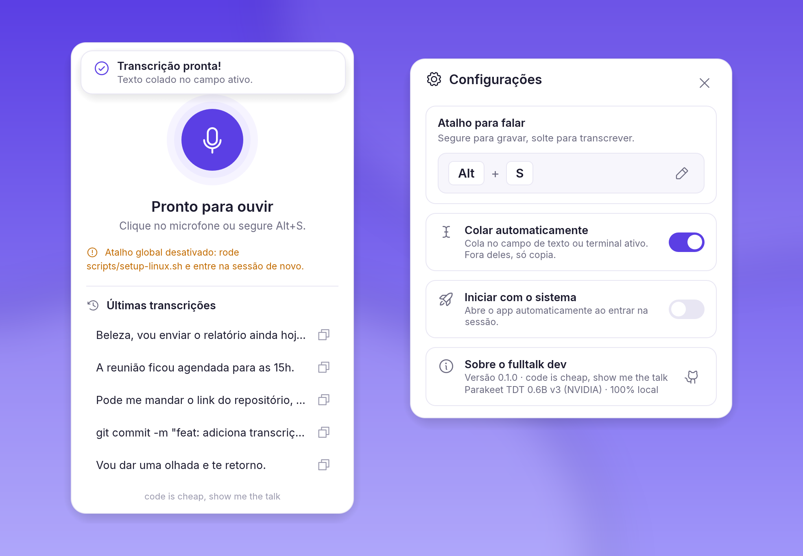
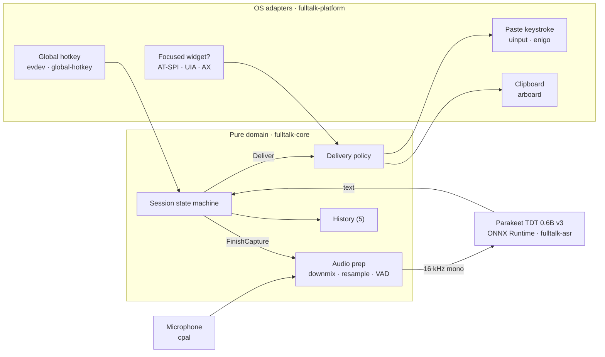

<div align="center">


# fulltalk dev

**code is cheap, show me the talk.**

Local push-to-talk dictation for developers. Hold a shortcut, speak Portuguese,
let go: the text lands in your editor, terminal or chat. Nothing leaves your machine.

[](https://github.com/RafaelFariaFerreira/fulltalk-dev/actions/workflows/ci.yml)


[](LICENSE)



</div>

## Features

- **Hold to talk**: hold <kbd>Alt</kbd>+<kbd>S</kbd> (configurable) anywhere, speak, release. Or click the mic to start and click again to stop.
- **Pastes where you are**: if a text field, text area or terminal has focus, the transcription is pasted there (with <kbd>Ctrl</kbd>+<kbd>Shift</kbd>+<kbd>V</kbd> in Linux terminals). Otherwise it just goes to the clipboard. It never pastes blindly.
- **Last 5 transcriptions**, one click to copy again. They survive restarts.
- **Always on top, never in the way**: a small floating window that doesn't steal focus when you click it.
- **100% local and offline** after a one-time ~670 MB model download. Runs on the CPU, no GPU required.
- **Light**: a single ~40 MB binary, about 0.8 GB of RAM (most of it is the model), ~0% CPU while idle.

## Performance

Measured on an Intel i7-8550U (4 cores / 8 threads, 2017 laptop), release build:

| Metric | Value |
|---|---|
| Transcription latency, 5 s of speech | **≈ 0.5 s** |
| Model load at startup (once) | ≈ 3.5 s |
| Resident memory, idle | ≈ 800 MB |
| CPU, idle | ≈ 0% (the UI only repaints while something changes) |

Two optimisations got memory down from 1.5 GB, and both are explained in code:

- **ONNX Runtime "lean" mode** turns off weight pre-packing, which keeps a second copy of every int8 weight. That saves about 450 MB for roughly 12% more latency ([`fulltalk-asr`](crates/fulltalk-asr/src/lib.rs)).
- **A pinned glibc `mmap` threshold** stops the hundreds of MB of model-loading temporaries from staying stuck in per-thread malloc arenas ([`memory.rs`](crates/fulltalk/src/memory.rs)).

## How it works



The project uses a **ports and adapters** layout split across four crates:

| Crate | Responsibility | Tests |
|---|---|---|
| [`fulltalk-core`](crates/fulltalk-core) | Session state machine, hold-to-talk chord detection, shortcut parsing, paste-or-clipboard policy, audio DSP, history, persistence. **No I/O, no `unsafe`.** | 87 unit tests + property tests |
| [`fulltalk-asr`](crates/fulltalk-asr) | Parakeet engine and a model installer that verifies each file's size and SHA-256 against a pinned upstream revision | offline installer tests with an in-memory fetcher |
| [`fulltalk-platform`](crates/fulltalk-platform) | Per-OS adapters behind the core's ports | pure classification and key-mapping logic tested on every OS |
| [`fulltalk`](crates/fulltalk) | egui app: controller, recorder, workers, UI | keymap, icon rasteriser, toasts |

Some decisions worth calling out:

- **The flow is a pure state machine.** [`Session::handle(Input) -> Vec<Effect>`](crates/fulltalk-core/src/session.rs) holds every rule: what a click does while recording, which input may stop a recording, what happens after a silent take. Each rule is unit-tested with no audio, model or window involved.
- **Pasting is never blind.** The delivery use case probes focus first, always fills the clipboard, and only sends a keystroke when a text input or terminal is known to have focus. If the paste fails, the text is still in the clipboard ([`delivery.rs`](crates/fulltalk-core/src/delivery.rs)).
- **Wayland is handled as a real platform, not ignored.** Wayland compositors forbid global key grabs, synthetic input and always-on-top for normal clients. On Linux the window therefore runs through XWayland (always on top, no focus stealing via `WM_HINTS`), the shortcut is read through evdev, and paste goes through a uinput virtual keyboard.
- **Focus detection works like a screen reader.** On Linux it tracks AT-SPI focus events and re-checks them live, falling back to a time-bounded tree search, so a frozen app can never freeze dictation ([`focus/linux.rs`](crates/fulltalk-platform/src/focus/linux.rs)).
- **Nothing blocks the UI thread.** The model download and load, inference and delivery each run on a worker thread and report back through events.

### Test-driven development

The domain was built test-first. One example: the chord tracker's first test run caught pressing <kbd>S</kbd> and then <kbd>Alt</kbd> being treated as the shortcut. The fix requires the main key to *complete* the chord, and `key_before_modifier_does_not_activate` keeps it that way.

```sh
cargo test --workspace          # 115 tests
cargo clippy --workspace --all-targets --all-features   # pedantic, zero warnings
```

CI runs `fmt`, `clippy -D warnings` and the full test suite on **Linux, Windows and macOS**.

## Getting started

### Requirements

- Rust (stable, edition 2024): <https://rustup.rs>
- A microphone

### Linux

```sh
git clone https://github.com/RafaelFariaFerreira/fulltalk-dev.git
cd fulltalk-dev
scripts/setup-linux.sh     # one time: ALSA headers, `input` group, /dev/uinput access
# log out and back in
scripts/install-linux.sh   # builds and adds "fulltalk dev" to your app menu
```

> [!WARNING]
> Joining the `input` group lets your user's processes read every keyboard. Wayland
> leaves no other way to get a hold-to-talk shortcut. If you skip it, the mic button
> and the clipboard still work.

### Windows / macOS

```sh
cargo run --release -p fulltalk
```

On macOS, grant **Accessibility** permission (System Settings → Privacy & Security). Paste and focus detection need it.

The first launch downloads the model (~670 MB) to the user data directory. Every launch after that works offline.

## Platform status

✅ verified on real hardware · 🧪 implemented and built and tested in CI, not yet verified on hardware

| | Linux (Wayland) | Linux (X11) | Windows | macOS |
|---|---|---|---|---|
| Transcription, UI, history, clipboard | ✅ | 🧪 | 🧪 | 🧪 |
| Hold-to-talk shortcut | 🧪 evdev | 🧪 global-hotkey | 🧪 global-hotkey | 🧪 global-hotkey |
| Paste into focused field | 🧪 uinput | 🧪 XTest | 🧪 SendInput | 🧪 CGEvent |
| Detect text field / terminal | ✅ AT-SPI | 🧪 AT-SPI | 🧪 UI Automation | 🧪 AX API |
| Always on top, click without stealing focus | 🧪 via XWayland | 🧪 | 🧪 `WS_EX_NOACTIVATE` | ⏳ planned |

Developed on Ubuntu 26.04 (GNOME, Wayland). Reports from other platforms are very welcome.

## Development

```sh
cargo run -p fulltalk                                  # the app (FULLTALK_LOG=debug for verbose logs)
cargo run --release -p fulltalk-asr --example transcribe -- <model-dir> file.wav   # benchmark
cargo run -p fulltalk-platform --example probe_focus  # what has focus right now?
scripts/screenshots.sh                                 # regenerate README images from the real app
```

`FULLTALK_HOME=/some/dir` moves settings and history out of your real profile, which is handy for testing.

## Credits

- [NVIDIA Parakeet TDT 0.6B v3](https://huggingface.co/nvidia/parakeet-tdt-0.6b-v3) (CC BY 4.0), with the int8 ONNX export by [istupakov](https://huggingface.co/istupakov/parakeet-tdt-0.6b-v3-onnx)
- [parakeet-rs](https://github.com/altunenes/parakeet-rs), [ONNX Runtime](https://onnxruntime.ai), [egui](https://github.com/emilk/egui)
- [Inter](https://rsms.me/inter/) (OFL) and [Phosphor Icons](https://phosphoricons.com) (MIT)

## License

[MIT](LICENSE) © Rafael Faria Ferreira
